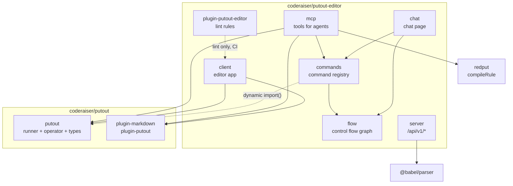

# Architecture

A map. Read the file you edit for details. Use this file to find where things are and which
seam owns what.

## Packages

| Package | Contents |
|---|---|
| `packages/client` | The editor: app, Redux store, CodeMirror panels. Unit and e2e tests. |
| `packages/chat` | The chat page: a message thread over the commands, and an AST tree. Builds to `out/chat/index.html`, served at `/chat`. |
| `packages/commands` | `@putout/editor-commands`: the command registry, `parseCommand`, `compactAST`/`queryAST`. A Node library: no React, no DOM. |
| `packages/flow` | `@putout/flow`: control flow graph. Source in, blocks and edges out. |
| `packages/server` | NestJS HTTP API behind `putout.cloudcmd.io` (`/api/v1/*`). |
| `packages/mcp` | MCP server for agents. See its `README.md`. |
| `packages/plugin-putout-editor` | 🐊**Putout** rules for this repository. Lint only: no code imports it. |

## How they relate



- **Client and mcp share no source.** They run two separate copies of the same rules.
- **`commands` exports no React component.** The mcp imports it and has no DOM.
  `index.spec.ts` asserts that the barrel has no `Ast*` or `use*` export.
- **`find`, `transform` and `validate` load 🐊**Putout** with a dynamic `import()`.**
  🐊**Putout** cannot run in a browser: it calls `os.homedir()` at module scope. In a browser
  these three commands answer that they need the server. The other commands work with no
  server. `packages/chat/rspack.config.js` lists what the bundle ignores.
- **A command line starts with the sigil `/`.** `packages/chat/src/sigil.ts` holds the sigil
  and `prefixOf`. The autocomplete, the `Enter` check and `Message` all use `prefixOf`.
- **The server does not use 🐊**Putout**.** It parses with `@babel/parser` and has its own
  `compactAST`/`queryAST`. A change to the client parser needs no server change.
- **The lint plugin is not a dependency.** The root `.putout.json` loads it by the bare name
  `putout-editor`.

## Client

`eslint-plugin-boundaries` enforces the client seams. The policy is in
`packages/client/config/boundaries-config.ts`. An edge that is not in the policy fails the lint.
Each element is a directory. An arrow means "may import".

```mermaid
graph TD
    app["app<br/>composition root"]

    layout["layout"]
    menu["menu"]
    panelSource["panel-source"]
    panelAst["panel-ast"]
    panelTransform["panel-transform"]
    panelCode["panel-code"]

    editorSource["editor-source"]
    editorTransform["editor-transform"]
    editorResult["editor-result"]
    editorAstJson["editor-ast-json"]
    editorAstTree["editor-ast-tree"]
    editor["editor<br/>qword wrapper"]
    ui["ui"]
    snippet["snippet"]
    store["store"]
    parser["parser"]

<!-- gen:client-imports -->

    app --> layout
    app --> menu
    app --> panelSource
    app --> panelAst
    app --> panelTransform
    app --> panelCode

    editor --> parser
    store --> editor
    store --> parser
    store --> snippet
    parser --> editor
    parser --> store
    snippet --> editor
    snippet --> store
    snippet --> parser
    ui --> editor
    ui --> store
    ui --> parser
    editorSource --> editor
    editorSource --> store
    editorSource --> parser
    editorResult --> editor
    editorResult --> editorAstJson
    editorAstJson --> editor
    editorTransform --> editor
    editorTransform --> editorResult
    editorTransform --> store
    editorTransform --> parser
    editorTransform --> ui
    editorAstTree --> editor
    editorAstTree --> editorAstJson
    editorAstTree --> store
    editorAstTree --> parser
    editorAstTree --> snippet
    panelSource --> editorSource
    panelSource --> ui
    panelSource --> store
    panelAst --> editorAstTree
    panelAst --> ui
    panelAst --> store
    panelTransform --> editorTransform
    panelTransform --> store
    panelCode --> editorResult
    panelCode --> store
    panelCode --> parser
    layout --> panelSource
    layout --> panelAst
    layout --> panelTransform
    layout --> panelCode
    layout --> ui
    menu --> editorTransform
    menu --> parser
    menu --> snippet
    menu --> store

<!-- /gen:client-imports -->

    style app fill:#eee
```

- **The arrows between the `gen:client-imports` markers are generated.** `scripts/gen-diagrams.mjs`
  reads them from `boundaries-config.ts`. `bun run lint` fails if the block is stale. Run
  `bun run gen:diagrams` to update it. Node lines and labels are written by hand.
- `app` may import every element. The diagram shows only the six edges it uses.
- `store` and `parser` import each other. `parserSelectors.ts` and `parserMiddleware.ts` are in
  `store/` because they take a `RootState`.
- `menu` is a leaf: no element may import it. So `ToolbarMenuContext` is in `store/`.
- No import cycle is allowed, runtime or type-only. `src/no-runtime-import-cycles.spec.ts`
  enforces this. Import from the file that defines a thing, not from a barrel that re-exports it.

## Client data flow

```text
parser category  ->  parse (src/parser)          ->  workbench.code / parseResult
transform plugin ->  transform (src/transformer) ->  workbench.transform
                     panels read the store, never each other
```

- `src/store`: `state.ts` has the state types and `initialState`. `revive.ts` has
  `persist`/`revive`. `reducers.ts` has the slice. `index.ts` is the barrel and the only entry
  from outside the directory. Inside `src/store`, import from the defining file.
- `src/app`: the composition root. `createStore.ts`, `persistence.ts`, `handlers.ts`,
  `debounce.ts`. Each takes its dependencies as arguments.
- `src/parser`: one directory per parser category. Each exports
  `id`/`displayName`/`mimeTypes`/`fileExtension`. `parsers/index.ts` registers the adapters.
  `src/store/operations.ts` runs `estreeToBabel` on every parser result, because all 🐊**Putout**
  rules use the Babel AST.
- `src/transformer`: compiles a plugin string and runs it. `init-plugin.ts` is the entry.
  It runs `compileRule`, which adds missing declarations (`remove`, `types` members) to the plugin.
- `src/panel-*`: render only. They read the store and dispatch actions.
- `src/snippet`: New-menu templates and fixtures, the share dialog, and `storage/`
  (`gist.ts`, `api.ts`). A stored snippet is `astexplorer.json` + `transform.js` + the source:
  `code.js` when `v === 1`, `source.<ext>` when `v === 2`.
- `src/editor/create-editor.ts`: adds `EditorState.allowMultipleSelections`. Vim blockwise visual
  needs it. See [`frontend.md`](./frontend.md#editor).

## Server

NestJS, four modules.

| Module | Routes | Uses |
|---|---|---|
| `gist` | `POST /`, `POST /:id/:revision`, `GET /:id/:revision` | `@octokit/rest` |
| `parse` | `GET /`, `GET /:snippetid/:revisionid` | `@babel/parser`, own `compactAST`/`queryAST` |
| `info` | `GET /` | |
| `transform` | none | an empty `@Module({})` |

`ServeStaticModule` serves `out/`. Unmatched GET requests get `out/index.html`, because the
editor has no router. The `exclude` pattern in `app.module.ts` makes a path that names a file
(for example `x.js`) get a 404 instead.

## MCP

Four tools run a plugin: `validate`, `find_places`, `transform`, `fetch_snippet`. The other tools
are reference and run no plugin code. The full tool list is in
[`tooling.md`](./tooling.md#mcp-server).

`get_example('markdown')` reads the installed `@putout/plugin-markdown` rule. A spec pins it.

## Tests and coverage

| Location | Runner | Scope |
|---|---|---|
| `src/**/*.spec.{ts,tsx}` | tape (supertape) | unit |
| `test/**/*.spec.ts` | tape | shared test helpers |
| `e2e/**/*.ts` | Playwright | end to end, on the prebuilt `out/` |

Coverage config is `.nycrc.json` (c8 reads it). Details: [`testing.md`](./testing.md).
