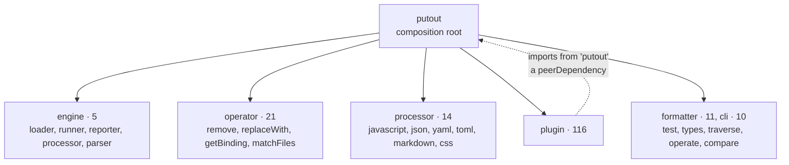

# 🐊**Putout** plugin house style

How to write a plugin that looks like a plugin from `coderaiser/putout`. The numbers are counts
over that repository: 188 packages, 116 plugins, 622 rule names, 770 rule files. For rules in
this repository, also read [`rules.md`](./rules.md).

## 0. Decisions, in order

1. Name: verb first, then source, then target.
2. Package shape: one rule → no `index.js`; several rules → a `rules` map.
3. Rule shape: start from `traverse`. Use `replace` only for a pure substitution.
4. Imports: from `putout` only.
5. Tests: `createTest`, a fixture pair, and a named negative case.

## Repository shape



- `putout` is the composition root: it depends on almost everything, and nothing depends on it.
- 114 of 116 plugins have no runtime dependency on another `@putout/*` package.

## 1. Name

| Verb | Rules | Means |
|---|---|---|
| `convert-` | 157 | A becomes B |
| `apply-` | 126 | use the better construct |
| `remove-` | 125 | delete noise |
| `add-` | 43 | add what is missing |
| `declare-` | 20 | declare a name so its import can be added |

- Never `no-console`, `eqeqeq` or a bare noun.
- Source then target: `convert-ternary-to-if`, `convert-index-of-to-includes`.
- A `/` namespace only for a dialect (`plugin-sql`: `postgres/convert-serial-to-identity`).
  Nest the directory to match.

## 2. Package shape

One rule (56 plugins): `main` is `lib/<rule>.js`, and the rule name is the package name minus
`plugin-`.

```text
plugin-apply-arrow/
    .madrun.js  .nycrc.json  .npmignore  LICENSE  README.md  eslint.config.js  package.json
    lib/apply-arrow.js
    test/apply-arrow.js
    test/fixture/apply-arrow.js  test/fixture/apply-arrow-fix.js
```

Several rules (60 plugins, median 7 rules): `lib/index.js` exports a `rules` map.

```js
import * as add from './add/index.js';
import * as convertLocToLock from './convert-loc-to-lock/index.js';

export const rules = {
    add,
    'convert-loc-to-lock': convertLocToLock,
};
```

- Key forms: shorthand `add,`, quoted `'a-b': rule`, and `'a-b': ['off', rule]` for a rule that
  is not on by default (63 rules).
- Do not write a `lib/index.js` for one rule.

`package.json`:

```json
{
    "name": "@putout/plugin-remove-useless-push",
    "type": "module",
    "main": "lib/remove-useless-push.js",
    "peerDependencies": {
        "putout": ">=41"
    },
    "devDependencies": {
        "@putout/test": "^15.8.2",
        "madrun": "^13.0.0"
    }
}
```

- `putout` is a `peerDependency`, never a `dependency`.
- `dependencies` only for third-party helpers (`try-catch`, `regexp.escape`).
- Write `main` even when it is the default.

## 3. Rule shape

| Export | Rule files | Use |
|---|---|---|
| `fix` | 409 | every fixable rule |
| `replace` | 359 | substitution; often imported by other rules |
| `traverse` | 290 | the default way to find a place |
| `match` | 162 | the guard of a replacer |
| `filter` | 62 | narrow an includer |
| `include` | 57 | node types to visit |
| `scan` | 50 | filesystem rules |
| `exclude` | 22 | skip subtrees |
| `find` | 8 | advanced; throws without `fix` |
| `declare` | 1 | `plugin-declare`: a name → import map |

### `traverse` + `fix`

```js
import {operator, types} from 'putout';

const {remove, getBinding} = operator;
const {isVariableDeclarator} = types;

export const report = () => `Avoid useless 'push()' to array `;

export const fix = (path) => {
    remove(path);
};

export const traverse = ({push}) => ({
    '__a.push(__args)': (path) => {
        const __a = path.get('callee.object').node;
        const binding = getBinding(path, __a.name);
        
        if (!binding)
            return;
        
        if (!isVariableDeclarator(binding.path.node))
            return;
        
        if (binding.referencePaths.length > 1)
            return;
        
        push(path);
    },
});
```

- Visitor key: a pattern string for a syntax shape, a node type when you need the parent.
- Guard with early `return`. Call `push(path)` after all guards. Each guard needs a
  `no report` test.
- `fix` gets what you pushed.

### `match` + `replace`

```js
import {types, operator} from 'putout';

const {extract} = operator;
const {
    isTemplateLiteral,
    isStringLiteral,
} = types;

export const report = () => `Use 'is-' function to check type`;

export const match = () => ({
    '__a.type === __b': check,
});

export const replace = () => ({
    '__a.type === __b': ({__b}) => `is${extract(__b)}(__a)`,
});

function check({__b}) {
    if (!isStringLiteral(__b) && !isTemplateLiteral(__b))
        return false;
    
    const value = extract(__b);
    
    if (!value)
        return false;
    
    return types[`is${value}`];
}
```

- A replacer with no `match` changes every instance of the pattern.
- `match`/`replace` and `traverse` are alternative shapes. Do not combine them in one rule.
- Prefer a template when one fits. Model: `apply-destructuring` in
  `@putout/plugin-logical-expressions`.
- No template exists for a `return` statement alone, a `this` receiver, or a CSS at-rule. Use an
  AST rule there.

### Other shapes

- `include` + `filter` + `fix`: `include` names node types, `filter` returns a boolean.
- `scan` + `fix`: filesystem rules. `matchFiles` builds them; they run under `redlint`.

```js
import {operator} from 'putout';
import * as convert from './convert/index.js';

const {matchFiles} = operator;

export const {
    report,
    fix,
    scan,
} = matchFiles({
    '__name.js -> __name.json': convert,
});
```

### Pattern strings

References: [`putout-script.md`](https://github.com/coderaiser/putout/blob/master/docs/putout-script.md)
and [`@putout/compare`](https://github.com/coderaiser/putout/tree/master/packages/compare#supported-template-variables).
Read them before you guess: mistakes fail silently.

| Value | Matches |
|---|---|
| `__` | any node |
| `__a` … `__z` | any node, linked: the value goes into the replacement |
| `__args` | zero or more arguments |
| `__object` | `ObjectPattern` or `ObjectExpression` |
| `__array` | `ArrayPattern` or `ArrayExpression` |
| `__imports` / `__exports` | any number of specifiers |
| `__args__a` | linked arguments |
| `"__a"` | any string literal |
| `/__a/` | any regexp literal |

- `__object` and `__array` need an expression position. `{a: 1};` alone is a block.
- The same name twice matches a repeated value: `'const __a = __b + __b'`.
- `'if (__a) __body;'` binds the body.

A replacement can use only names that the key binds:

| key → replacement | Result |
|---|---|
| `'f(__a)'` → `'g(__a)'` | `g(1);` |
| `'f(__)'` → `'g(__)'` | `g(1);` |
| `'f(__)'` → `'g(__a)'` | `☝️ Looks like template values not linked` |
| `'f(__a)'` → `'g(__b)'` | `☝️ Looks like template values not linked` |
| `'f(__a__)'` → `'g(__a__)'` | `f(1);` unchanged, exit 0 |

The engine caches compiled templates in a process. Test a surprising pattern alone, in a new
process.

## 4. Imports

| Import | Uses |
|---|---|
| `operator` from `putout` | 400 |
| `types` from `putout` | 304 |
| `template` from `putout` | 58 |
| `print` / `parse` from `putout` | 30 |
| `try-catch`, `node:path` | 25 |

Write `import {operator, types} from 'putout';`, then destructure `operator` first.

Common `operator` members: `remove`, `replaceWith`, `compare`, `setLiteralValue`,
`getTemplateValues`, `rename`, `getProperties`, `getBinding`, `readFileContent`,
`writeFileContent`, `insertAfter`, `insertBefore`, `superTraverse`, `extract`, `matchFiles`,
`__json`/`__yaml`/`__toml`/`__markdown`.

`types` is `@babel/types`: `isX(node)` tests, `x(...)` builds. There is no `types.isComment`.
`types.is` is not "is a known type": it returns `false`. Name the concrete predicate.

## 5. Tests

`createTest` from `@putout/test` in 116 of 116 plugins.

```js
import {createTest} from '@putout/test';
import * as plugin from '../lib/remove-useless-push.js';

const test = createTest(import.meta.url, {
    plugins: [
        ['remove-useless-push', plugin],
    ],
});

test('putout: remove-useless-push: report', (t) => {
    t.report('remove-useless-push', `Avoid useless 'push()' to array `);
    t.end();
});

test('putout: remove-useless-push: transform', (t) => {
    t.transform('remove-useless-push');
    t.end();
});
```

- Test name: `putout: <rule>: <what>`, where `<what>` is `report`, `transform`,
  `no report: <case>` or `no transform: <case>`.
- `t.transform('name')` compares `fixture/name.js` with `fixture/name-fix.js`.
- A fixture for a `no*` test has no `-fix` file (203 such fixtures upstream).
- Generate `-fix` files with `UPDATE=1`, then read them.
- `t.reportCode` / `t.transformCode` for a one-line case with no fixture.
- 100% coverage, `checkCoverage: true`, in every `.nycrc.json`.

## 6. README

Five parts in this order: title with npm badge, one-line description, `## Install`, the `rules`
JSON for `.putout.json`, then one section per rule with `## ❌ Example of incorrect code` and
`## ✅ Example of correct code`. A `js` fence in a README is linted as real code.

## 7. Checklist

- [ ] Name: verb first, `A-to-B` for a conversion
- [ ] One rule → `lib/<rule>.js` and `main`; several → `lib/index.js` with `rules`
- [ ] `putout` in `peerDependencies`; no other `@putout/*` runtime dependency
- [ ] `traverse` + `fix`, unless it is a substitution
- [ ] Imports from `putout` only
- [ ] `createTest`, a fixture pair, `report` and `transform` tests
- [ ] One `no report` test per guard
- [ ] README with ❌/✅ pairs; the fences pass the lint
- [ ] 100% coverage
- [ ] `putout .` clean: no optional chaining, no `node.type ===`

### Never

- `find` without `fix`. For no safe fix, use a `replace` that returns the node unchanged
  (`check-match` in `@putout/plugin-putout`), and test that the file does not change.
- A `report` that does not name the problem.
- A runtime `@putout/*` dependency. A bundled copy of `putout` has different `types` functions.

### Exceptions upstream (do not copy)

- `plugin-browserlist`: CommonJS.
- `plugin-browserlist`, `plugin-convert-is-nan-to-number-is-nan`,
  `plugin-convert-spread-to-array-from`: no `.madrun.js`.
- `plugin-typescript`: `main` is an aggregator, `lib/export.js`.
